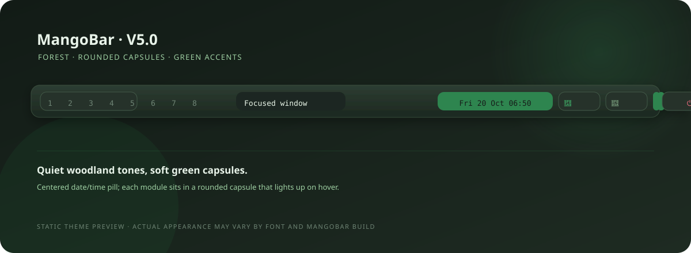

# MangoBar V5.0 — Forest

A rounded-capsule bar with dark woodland tones, soft green accents, and a centered date/time pill. Workspaces sit on the left; network, notifications, CPU, memory, sound, and power controls sit on the right.



## Install

From the repository root, run the installer and choose **option 6**:

```bash
./install.sh
```

The installer copies `config.jsonc`, `style.css`, and the scripts in `scripts/` to `~/.config/mangobar/`. Existing managed files are backed up under `~/.config/mangobar-v5.0-backup-*`.

## Controls

- Click a workspace to activate it, right-click to toggle it, and scroll over the workspace list to switch between occupied workspaces.
- Click the centered date/time pill to open a calendar.
- Click the Wi-Fi/network icon to open NetworkManager connection settings.
- Click the bell to toggle the SwayNotificationCenter panel.
- Click CPU or memory usage to open a system monitor.
- Click the sound icon to mute/unmute. Scroll over it to adjust volume.
- Click the power icon to open the lock, log out, restart, and power-off menu. Destructive actions require confirmation.

MangoBar displays CPU and memory percentages using its native modules.

## Optional desktop applications

The bar itself uses MangoBar's native modules. These optional applications provide the click actions:

- **Notifications:** `swaync` and `swaync-client`, with SwayNotificationCenter running in the session.
- **Network settings:** `nm-connection-editor` or GNOME Control Center.
- **Calendar:** GNOME Calendar, `gsimplecal`, or `yad`.
- **System monitor:** GNOME System Monitor, Mission Center, XFCE Task Manager, or MATE System Monitor.
- **Power menu:** `wofi`, `rofi`, or `fuzzel`; `swaylock` or `gtklock` for the lock action.

If an optional application is unavailable, the matching click action reports the missing dependency instead of silently doing nothing. Audio control uses `wpctl` from PipeWire/WirePlumber.

The Nerd Font symbols in the config and stylesheet are best displayed with **JetBrainsMono Nerd Font** or another installed Nerd Font. MangoWM/MangoBar and desktop dependencies are not installed by this theme installer.
